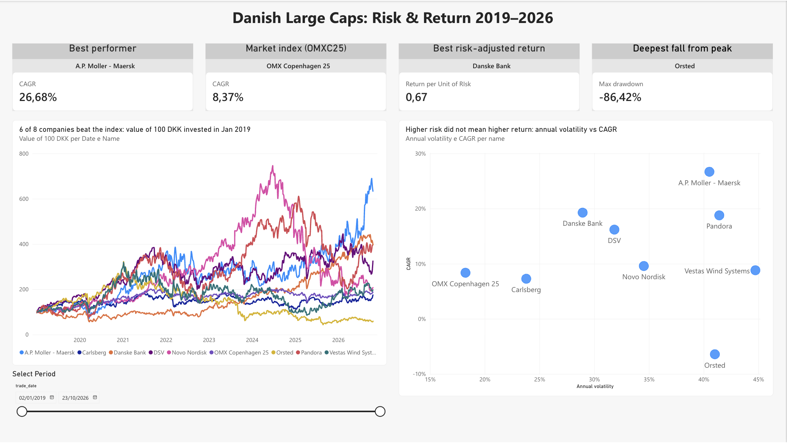
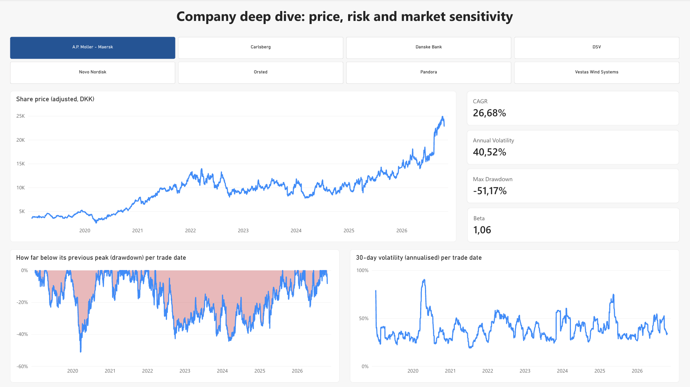

# Danish Large Caps: Risk & Return 2019–2026 | PostgreSQL + Power BI

Which of Denmark's largest listed companies actually rewarded shareholders since 2019, and how much risk did they take to do it?

I compared 8 large companies on Nasdaq Copenhagen against the OMX Copenhagen 25 index, using daily prices from January 2019 to October 2026. All return and risk measures are calculated in SQL (PostgreSQL) and visualised in a two-page Power BI report.



## Companies

| Company | Sector |
|---|---|
| A.P. Moller - Maersk | Shipping & Logistics |
| DSV | Shipping & Logistics |
| Novo Nordisk | Healthcare |
| Carlsberg | Consumer Staples |
| Pandora | Consumer Discretionary |
| Vestas Wind Systems | Energy & Utilities |
| Ørsted | Energy & Utilities |
| Danske Bank | Financials |

Benchmark: **OMX Copenhagen 25 (OMXC25)**.

## Key insights

1. **Maersk was the best performer, but also one of the riskiest.** It returned **26.7% a year** (100 DKK invested in January 2019 became about 634 DKK), with an annual volatility of **40.5%**.
2. **Danske Bank had the best return for the risk taken.** It returned **19.3% a year** with **28.9%** volatility, a return-per-risk ratio of **0.67**, the highest in the group. It was also one of the least market-sensitive stocks (beta **0.69**).
3. **Higher risk did not mean higher return.** Vestas was the most volatile stock (**44.7%**) and the most sensitive to the market (beta **1.49**), yet returned only **8.8% a year**, about the same as the index (**8.4%**). Ørsted, with similar volatility, lost **6.4% a year**.
4. **Even the largest companies can fall very far.** From their peaks, Ørsted fell **−86%**, Novo Nordisk **−77%**, Vestas **−73%** and Pandora **−67%**. The index never fell more than **−30%**, which shows the value of diversification.
5. **Market sensitivity changes over time.** Novo Nordisk's yearly beta rose from **0.72** in 2022 to **1.6–1.7** in 2024–2026. Carlsberg stayed defensive every year (beta **0.35–0.84**), but its **7.3%** yearly return was below the index.

## Results table

| Company | CAGR | Annual volatility | Return / risk | Max drawdown | Beta | Correlation with index |
|---|---|---|---|---|---|---|
| Danske Bank | 19.3% | 28.9% | 0.67 | −47.9% | 0.69 | 0.43 |
| A.P. Moller - Maersk | 26.7% | 40.5% | 0.66 | −51.2% | 1.06 | 0.48 |
| DSV | 16.2% | 31.8% | 0.51 | −48.1% | 1.19 | 0.68 |
| *OMX Copenhagen 25 (index)* | *8.4%* | *18.2%* | *0.46* | *−29.8%* | | |
| Pandora | 18.8% | 41.4% | 0.45 | −66.8% | 1.00 | 0.44 |
| Carlsberg | 7.3% | 23.8% | 0.31 | −39.5% | 0.58 | 0.44 |
| Novo Nordisk | 9.6% | 34.5% | 0.28 | −76.8% | 1.10 | 0.58 |
| Vestas Wind Systems | 8.8% | 44.7% | 0.20 | −73.0% | 1.49 | 0.61 |
| Ørsted | −6.4% | 41.0% | −0.16 | −86.4% | 1.06 | 0.47 |

Period: 2 January 2019 – 23 October 2026.

## Company deep dive

The second page lets you pick one company and see its price, its fall from the previous peak (drawdown), its 30-day volatility and its key figures.



## How it was built

```
Yahoo Finance  →  Python (download_data.py)  →  CSV  →  PostgreSQL (SQL views)  →  Excel  →  Power BI
```

1. **Data collection:** `download_data.py` downloads daily prices (with dividend- and split-adjusted close) for the 8 companies and the index using the `yfinance` library. That is 17,525 rows in total.
2. **Database:** the CSV files are loaded into three PostgreSQL tables (`companies`, `prices`, `fundamentals`).
3. **Analysis in SQL:** each step is a view, so the logic is transparent and easy to check:

| Script | What it calculates | SQL used |
|---|---|---|
| [`02_daily_returns.sql`](sql/02_daily_returns.sql) | daily returns, plus a check for days moving more than ±15% | `LAG` |
| [`03_data_cleaning.sql`](sql/03_data_cleaning.sql) | correction of the Ørsted rights issue (see below) | `UPDATE` |
| [`04_cumulative_performance.sql`](sql/04_cumulative_performance.sql) | value of 100 DKK invested in January 2019, CAGR | `FIRST_VALUE`, `POWER` |
| [`05_risk.sql`](sql/05_risk.sql) | annualised and rolling 30-day volatility, drawdown, max drawdown | `STDDEV` over a window, running `MAX` |
| [`06_beta_correlation.sql`](sql/06_beta_correlation.sql) | beta and correlation with the index, also year by year | `REGR_SLOPE`, `CORR` |
| [`07_dashboard_exports.sql`](sql/07_dashboard_exports.sql) | two final tables for the dashboard | joins between views |

4. **Power BI:** the two final tables are loaded into the Power BI service. A one-to-many relationship on `ticker` links the company table (one row per company) to the daily table (one row per company per day), so the company selector filters every visual on page 2.

## Data quality

- **Ørsted rights issue (September 2025):** Yahoo Finance adjusted only a few days of prices, which created an artificial −44.9% drop on 8 September 2025. I found it with the ±15% check and corrected all earlier prices with the theoretical ex-rights price (TERP) factor: (204.5 + 15/7 × 66.60) / (1 + 15/7) = 110.48 DKK, so the factor is 110.48 / 204.5 = 0.5402.
- **Beta** is calculated only on days when both the stock and the index have a return. Holidays can differ between the series.

## Limitations

- The OMXC25 series is a **price index** (no dividends), while the company prices are **adjusted for dividends**. The comparison with the index is therefore slightly favourable to the companies.
- The KPI cards and the risk-vs-return chart cover the **whole period**. The period slicer on page 1 only filters the line chart, which keeps its base of 100 on 2 January 2019.
- Annual fundamentals were downloaded but are not yet used in the dashboard.

## Repository structure

```
├── README.md
├── download_data.py      downloads prices and fundamentals from Yahoo Finance
├── csv_to_excel.py       turns the two SQL exports into one Excel file for Power BI
├── sql/                  01–07: tables, cleaning, analysis views, exports
└── images/               dashboard screenshots
```

The data files are not included. Run `download_data.py` to recreate them.

## How to reproduce

1. `pip3 install yfinance pandas openpyxl`, then `python3 download_data.py`
2. In PostgreSQL, run `sql/01_create_tables.sql`, import the CSV files from `data/`, then run scripts 02 to 07 in order.
3. Export the two `SELECT` results in `07_dashboard_exports.sql` to `exports/` as CSV, then run `python3 csv_to_excel.py`.
4. Upload `exports/danish_large_caps.xlsx` to Power BI.

## Tools

PostgreSQL · pgAdmin · SQL window functions · Python (pandas, yfinance) · Power BI service · Power Query

---

*Educational analysis, not investment advice.*
